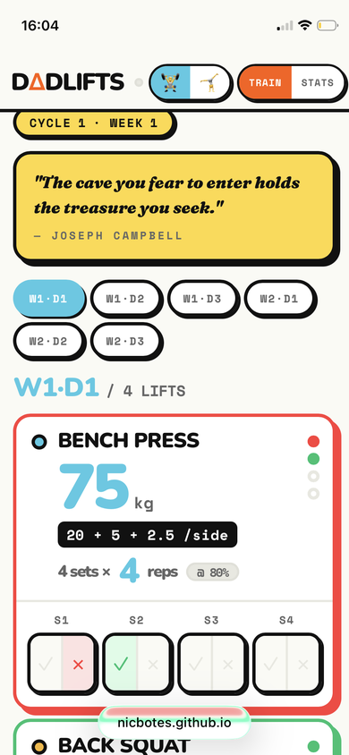
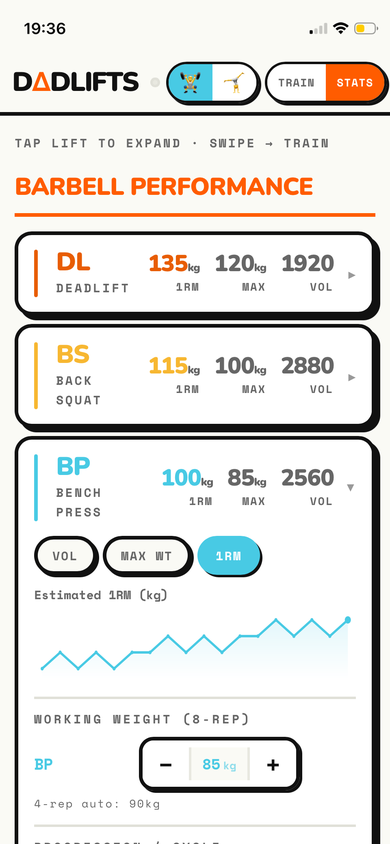
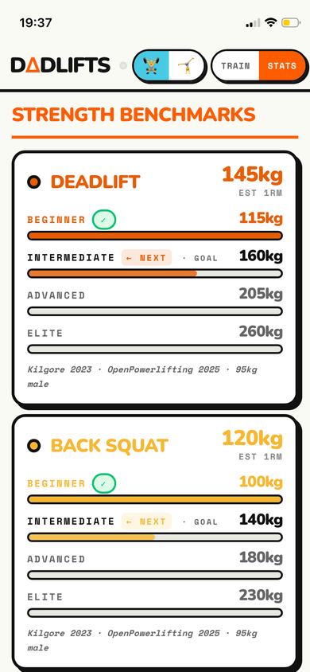
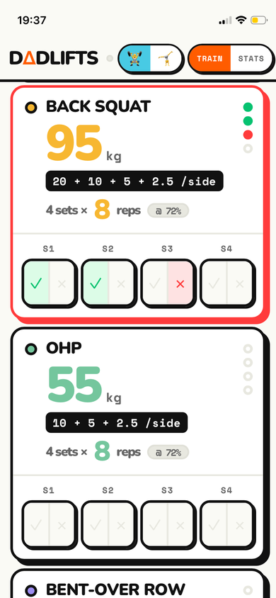
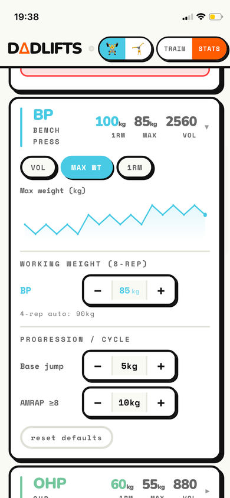

# DΔDLIFTS 🏋️

Personal training tracker. Barbell + calisthenics + kettlebell, plus a beer tracker for cutting down. Built between sets, to stay in the game.

**Live PWA:** https://nicbotes.github.io/dadlifts/

---

## Screenshots

<div align="center">

| Train | Stats | Benchmarks |
|:---:|:---:|:---:|
|  |  |  |

| Fail modal | Chart |
|:---:|:---:|
|  |  |

</div>

---

## What it is

A home screen PWA for tracking the [Ivysaur 4-4-8](https://www.liftosaur.com/programs/ivysaur-4-4-8) barbell programme alongside a calisthenics skill progression stack.

**Barbell:** Deadlift · Back Squat · Bench Press · OHP · Bent-Over Row  
**Calisthenics:** Front Lever · Dead Hang · Wall Handstand · Wall HSPU · L-Sit · Muscle-Up

**Beer tracker (🍺):** log millilitres with time and trigger, beat urges with a 20-minute surf timer, see streaks, danger windows, triggers, a research-based brain-rewiring timeline and a withdrawal guide. CSV/JSON export. A 5pm (SAST) push notification suggests an alternative: sparkling water from the fridge, tonight's training session, a walk. A 7:30pm check-in asks whether you stayed dry or had beer, and logs the volume. Notifications are sent by a scheduled GitHub Actions workflow, with no backend; setup is in [DEPLOY.md](DEPLOY.md#beer-notifications-5pm-nudge-730pm-check-in). See [docs/BEER_TRACKER_PLAN.md](docs/BEER_TRACKER_PLAN.md).

**Install:** Open https://nicbotes.github.io/dadlifts/ in Safari → Share → Add to Home Screen

---

## Architecture

```
GitHub Pages PWA (standalone, localStorage)
GitHub Actions: deploy on merge to main · scheduled beer notifications
```

- **Standalone mode** (`VITE_STANDALONE=true`) — pure localStorage, no backend, works offline. This is the app.
- **Deploy** — merge to `main`; `.github/workflows/pages.yml` publishes to GitHub Pages. See [DEPLOY.md](DEPLOY.md).
- **Legacy** — the Express + SQLite backend (`server/`, `cli/`, VPS token URLs) is no longer used.

---

## Programme: Ivysaur 4-4-8

3 days/week, 2-week rotating cycle (6 sessions):

| Day | Schedule |
|-----|----------|
| W1·D1 | Bench 4×4 · Squat 4×8 · OHP 4×8 · Rows 4×4 |
| W1·D2 | Bench 4×8 · Deadlift 4×4 · OHP 4×4 · Rows 4×8 |
| W1·D3 | Bench AMRAP · Squat AMRAP · OHP 4×8 · Rows 4×4 |
| W2·D1 | Bench 4×8 · Deadlift 4×8 · OHP 4×4 · Rows 4×8 |
| W2·D2 | Bench 4×4 · Squat 4×8 · OHP 4×8 · Rows 4×4 |
| W2·D3 | Bench 4×8 · Deadlift AMRAP · OHP AMRAP · Rows 4×8 |

- **4-rep days:** 80% 1RM
- **8-rep days:** 72% 1RM
- **2 fails on same lift** = deload flag = hold weight next cycle

---

## Stack

- **Frontend:** React 18 + Vite
- **Storage:** browser localStorage (no backend)
- **Deploy:** merge to `main` → GitHub Actions → GitHub Pages
- **Notifications:** Web Push from a scheduled GitHub Actions workflow
- **Legacy, unused:** Express + SQLite backend and CLI

---

## Agent / OpenClaw (legacy)

The backend these commands talk to is no longer used. Kept for reference only.
See [AGENTS.md](AGENTS.md) and [SKILL.md](SKILL.md).

```bash
# Redeploy
node cli/deploy.js

# Add a user
DADLIFT_BASE_URL=http://your-vps node cli/setup.js --name "Name"

# Read training data
node cli/dadlift.js snapshot

# Beer tracker
node cli/dadlift.js beer                    # insights
node cli/dadlift.js beer-log 440 winddown   # log a beer
node cli/dadlift.js beer-resist walk bored  # urge beaten
node cli/dadlift.js beer-export > beer.csv
```
